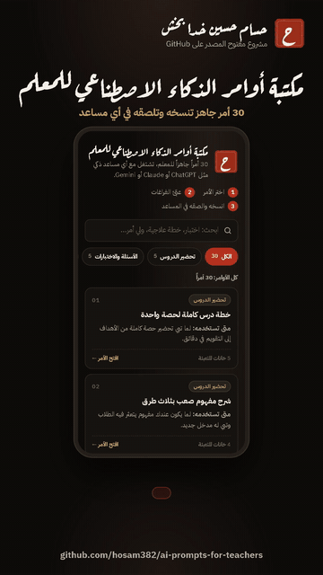

# مكتبة أوامر الذكاء الاصطناعي للمعلم | AI Prompts for Teachers
**By [Hassam](https://github.com/hosam382)**

**جرّبها الآن | Live:** https://hosam382.github.io/ai-prompts-for-teachers/



[شاهد فيديو الشرح كامل مع الموسيقى (MP4)](demo.mp4)

## وش هي؟

صفحة فيها 30 أمراً عربياً جاهزاً للمعلم، تشتغل مع أي مساعد ذكاء اصطناعي مثل ChatGPT أو Claude أو Gemini.
تختار الأمر، وتعبّي الفراغات مثل [المادة] و[الصف]، وتشوف الأمر النهائي قدامك وهو يتحدث، وتنسخه بضغطة.

كل أمر مكتوب بعناية:
- يحدد للمساعد دوره («أنت معلم خبير في...») ويعطيه السياق.
- يطلب شكل إخراج واضح: جداول وقوائم مرقمة وأزمنة محسوبة.
- يطلب منه يكتب افتراضاته بوضوح إذا نقصته معلومة.
- يمنعه يخترع أسماء طلاب أو درجات، أو ينسب المحتوى لصفحات كتاب معيّن.

## الأقسام

| القسم | أمثلة من الأوامر |
|---|---|
| تحضير الدروس | خطة درس كاملة، شرح مفهوم صعب بثلاث طرق، أفكار تمهيد، نشاط بثلاثة مستويات، ورقة مراجعة |
| الأسئلة والاختبارات | اختيار من متعدد مع مفتاح الإجابة، اختبار بجدول مواصفات، بطاقة خروج، سلّم تقدير، أسئلة تفكير عليا |
| الخطط العلاجية والإثرائية | خطة علاجية، خطة إثرائية، اختبار تشخيصي، ورقة عمل متدرجة، المفاهيم الخاطئة الشائعة |
| التقارير والنماذج | عبارات ملاحظات التقارير، محضر اجتماع، تقرير نشاط، تحليل نتائج اختبار، خطاب رسمي |
| التواصل مع أولياء الأمور | رسالة ملاحظة، رسالة شكر، تحضير لقاء، إعلان للفصل، دليل الأسرة للمذاكرة في البيت |
| أنشطة صفية وتفاعلية | لعبة مراجعة، نشاط تعاوني بأدوار، مشكلة من الواقع، نقاش صفي، حصة محطات |

## طريقة الاستخدام

1. ابحث بكلمة (البحث يتجاهل التشكيل والهمزات) أو اختر قسماً، واضغط على الأمر اللي تبيه.
2. عبّئ الخانات: المادة، والصف، وعدد الأسئلة... والخانة اللي تتركها فاضية تبقى بين قوسين وتكملها في المساعد.
3. اضغط «انسخ الأمر» والصقه في المساعد اللي تستخدمه، أو «انسخ بدون تعبئة» إذا تبي النص الأصلي.
4. راجع أي نتيجة قبل ما تستخدمها مع طلابك.

تقدر ترسل رابط أمر معيّن لزميلك مباشرة، مثل:
https://hosam382.github.io/ai-prompts-for-teachers/#lesson-plan

## الخصوصية

- الصفحة ما ترسل أي شي لأي مكان: لا تحليلات، ولا خطوط من برّا، ولا خوادم. كل شي يصير في متصفحك.
- اللي تكتبه في الخانات ما ينحفظ، ويروح أول ما تقفل الصفحة.
- لا تلصق أسماء الطلاب أو أرقام هوياتهم أو درجاتهم الفردية في أي مساعد ذكاء اصطناعي، واكتب وصفاً عاماً بدلها.

## شارك بأمر جديد

عندك أمر جربته ونفعك؟ افتح [Issue](https://github.com/hosam382/ai-prompts-for-teachers/issues) واكتب فيه الأمر وقسمه ومتى يُستخدم،
أو أرسل Pull Request يضيفه إلى `PROMPTS` في ملف `prompts.js`:

- اكتب الفراغات بين قوسين مربعين مثل `[المادة]`، وأضف مثالاً لكل فراغ جديد في `HINTS`.
- ابدأ الأمر بدور المساعد («أنت ...»)، وحدد شكل الإخراج، واختم بالقواعد المشتركة `${BASE}`.
- لا تذكر صفحات أو وحدات من كتاب معيّن، ولا تطلب بيانات طلاب حقيقية.
- شغّل الاختبارات وتأكد إنها كلها تنجح.

## English

A small static page with 30 carefully written Arabic prompts for teachers. It works with any AI assistant
(ChatGPT, Claude, Gemini...). Pick a prompt, fill its blanks such as `[المادة]` (subject) and `[الصف]` (grade),
watch the live preview, and copy it in one click, or copy the raw template.

- **Six categories:** lesson planning, questions and tests, remedial and enrichment plans, reports and forms,
  parent communication, and classroom activities.
- **Good prompt hygiene:** every prompt sets a role, gives context and constraints, asks for a clear output
  format (tables, numbered lists), asks the model to state its assumptions, and forbids inventing student data
  or citing specific textbook pages.
- **Arabic-aware search:** ignores diacritics and tatweel, and treats أ إ آ as ا, ة as ه, and ى as ي.
- **Private by design:** no network requests at runtime, no analytics, no storage. Fonts are bundled.
- **Deep links:** `#lesson-plan`, `#mcq-bank`, ... open a prompt directly.

Files: `index.html`, `style.css`, `app.js` (UI), `prompts.js` (data and pure functions:
`placeholders`, `fill`, `segments`, `normalize`, `search`), `prompts.test.js`.

بُني بمساعدة الذكاء الاصطناعي (Claude) وراجعه حسام.

Built with AI assistance (Claude), reviewed by Hassam.

## تشغيل الاختبارات | Run tests

Node.js 18 or newer, no dependencies:

```
node --test
```

To run the page locally (ES modules need a server, not `file://`):

```
python -m http.server 8000
```

Then open http://localhost:8000/

## License

MIT. See [LICENSE](LICENSE).
